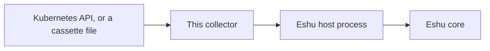

# eshu-collector-kubernetes-live

**Status: pre-release.** Eshu core still owns this data in
production. This repo has no authority to publish facts on its own
yet.

In a nutshell: this collector reads live Kubernetes cluster
metadata and hands Eshu evidence about workloads, namespaces,
service accounts, and access rules in one cluster. Eshu can then
answer what is running where and which identities those workloads
use. The collector only collects and returns evidence; it doesn't
store anything itself and never changes the cluster.

In text: Kubernetes API (or a recorded cassette file) -> this
collector -> Eshu host process -> Eshu core.

## When to use it

Use it when Eshu needs current evidence about one Kubernetes
cluster: workloads and their pod shapes, namespaces, service
accounts, RBAC roles and bindings, and cloud identity links such
as EKS IRSA, EKS Pod Identity, and GKE Workload Identity.

## When not to use it

- Don't use it to change a cluster. It only lists objects.
- Don't use it to read Secret or ConfigMap contents.
  Those payloads are excluded by design.
- Don't use one activation for many clusters.
  One target covers one cluster; a claim whose scope matches no
  target is rejected instead of scanning the wrong cluster.
- Don't use cassette replay to prove live access.
  Replay needs no credentials and proves only the recorded shape.

## How Eshu runs it

The host runs one claim per process invocation.
With no arguments (or `--sdk-stdio`) the binary reads one
`collector-sdk/v1alpha1` request from stdin and writes one result
to stdout. The host owns claims and commits; this binary never
commits facts itself.

## Documentation

Start at the [docs index](docs/README.md). Shortcuts people use most:

| Page | What you'll find there |
|---|---|
| [Getting started](docs/getting-started/README.md) | Run it once, see facts come back |
| [Configuration](docs/reference/configuration.md) | Every config field, credentials, and the claim budget |
| [Facts](docs/reference/facts.md) | The fact kinds it emits, mirroring the manifest |
| [Diagrams](docs/diagrams/README.md) | Every diagram, with captions and text versions |

## Related repos

- [eshu](https://github.com/eshu-hq/eshu), Eshu core
- [eshu-sdk](https://github.com/eshu-hq/eshu-sdk), collector and fact-schema contracts
- [eshu-deploy](https://github.com/eshu-hq/eshu-deploy), deployment charts and activations

Exact `go.mod` pins: `github.com/eshu-hq/eshu-sdk/collector v0.1.0-rc.4` and
`github.com/eshu-hq/eshu-sdk/factschema v0.1.0-rc.7`. Proof carried by the
test suite includes full-harness conformance for `kubernetes_live.*` facts
including `pod_template` (`TestExtractedPayloadsPassConformance`),
pack-schema conformance for all 13 emitted kinds, and synthetic-fixture
conformance for `k8s_rbac_role`, `k8s_rbac_binding`, and
`eks_pod_identity_association`. In a pod template,
`containers.env_from_secret` is only a yes/no flag that a container
references secret-backed environment; it never carries a value.

## Development

Run `make ci` to check a change the way CI does.

## Contributing, security, and license

See [CONTRIBUTING.md](CONTRIBUTING.md) before opening a change.
There's no `SECURITY.md` in this repo.
Licensed under MIT; see [LICENSE](LICENSE).
