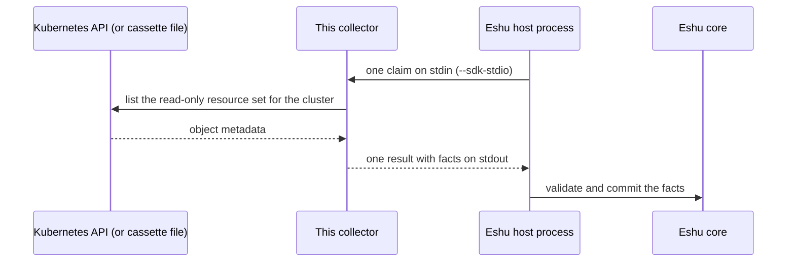

# eshu-collector-kubernetes-live

**Status: pre-release.** Eshu core still owns this data in production.
This repo has no authority to publish facts on its own yet.

This collector reads live Kubernetes cluster metadata and hands Eshu
evidence about workloads, namespaces, service accounts, and access
rules in one cluster, so you can answer what is running where and
which identities those workloads use.

A *fact* is one small, typed piece of evidence.
A *claim* is one bounded request to collect one cluster.
The *host* is the Eshu process that starts this collector, sends it a
claim, and stores the result.
Evidence here is metadata only: names, shapes, and links, never
secret values or config payloads.
This collector only collects and returns evidence. It does not store anything itself and never changes the cluster.

## What it collects

The table below is generated from `spec.emittedFacts` in
[manifest.yaml](manifest.yaml).
That file declares 13 fact kinds with `reported` confidence (the
cluster API reported it).
`kubernetes_live.pod_template` is at schema `1.3.0`; the other twelve
are at `1.0.0`.

| Fact kind | Plain meaning |
|---|---|
| `kubernetes_live.pod_template` | The pod shape a workload asks Kubernetes to run |
| `kubernetes_live.relationship` | One link between two Kubernetes objects |
| `kubernetes_live.warning` | Part of the cluster could not be read fully |
| `kubernetes_live.namespace` | One namespace seen in the cluster |
| `k8s_service_account` | One service account (a workload identity) |
| `k8s_rbac_role` | One RBAC role: a set of allowed actions |
| `k8s_rbac_binding` | One binding of a role to identities |
| `k8s_workload_identity_use` | A workload using a cloud identity |
| `k8s_gcp_workload_identity_binding` | A service account bound to a Google Cloud identity |
| `k8s_service_account_token_posture` | How a service account token is mounted and exposed |
| `eks_irsa_annotation` | An EKS annotation that links a service account to an AWS role |
| `eks_pod_identity_association` | An EKS Pod Identity link for a service account |
| `secrets_iam_coverage_warning` | Secrets or IAM coverage was partial for this scope |

RBAC is Kubernetes role-based access control: rules that say who may
do what.
IRSA is IAM Roles for Service Accounts, the EKS feature that gives a
pod an AWS identity.
The collector never emits Secret values, ConfigMap data payloads, or
environment variable values.
`containers.env_from_secret` in a pod template is only a yes/no flag
that a container references secret-backed environment; it never
carries a value.

## How it fits in



In text: Kubernetes API (or a recorded cassette file) -> this collector -> Eshu host process -> Eshu core. A cassette is a recorded cluster snapshot the collector can replay with no cluster and no credentials.

## When to use it

Use it when Eshu needs current evidence about one Kubernetes
cluster: workloads and their pod shapes, namespaces, service
accounts, RBAC roles and bindings, and cloud identity links such as
EKS IRSA, EKS Pod Identity, and GKE Workload Identity.

## When not to use it

- Do not use it to change a cluster. It only lists objects.
- Do not use it to read Secret or ConfigMap contents.
  Those payloads are excluded by design.
- Do not use one activation for many clusters.
  One target covers one cluster; a claim whose scope matches no
  target is rejected instead of scanning the wrong cluster.
- Do not use cassette replay to prove live access.
  Replay needs no credentials and proves only the recorded shape.

## How Eshu runs it

The host runs one claim per process invocation.
With no arguments (or `--sdk-stdio`) the binary reads one
`collector-sdk/v1alpha1` request from stdin and writes one result to
stdout.
The host validates the result and owns claims and commits.

```bash
go build -o /tmp/collector ./cmd/collector
echo "$REQUEST" | /tmp/collector --sdk-stdio
/tmp/collector seed --dest /component
```

`seed` writes `DIR/collector` (this binary, mode `0755`) and
`DIR/manifest.yaml` (mode `0644`) so an init container can install
the component without a shell.
`--image-ref REF@sha256:<digest>`, or `COLLECTOR_IMAGE_REF` when the
flag is absent, stamps the deployed digest into the seeded manifest;
an image cannot embed its own digest, so [manifest.yaml](manifest.yaml)
in this repo keeps the all-zero placeholder digest.
The image entrypoint is `/usr/local/bin/collector` with default
argument `--sdk-stdio` (see [Dockerfile](Dockerfile)).
Cluster access resolves in this order: an explicit `KUBECONFIG`
file wins, otherwise the in-cluster service account.
When neither exists, the claim returns a bounded retryable error.

## Configuration

Copy [config.example.yaml](config.example.yaml).
The host forwards the activation `config` object as the request
config, either one target object or `{"targets":[...]}` matched by
claim scope.
Host-minted `host_*` keys are accepted and ignored; any other unknown
top-level key fails closed without naming the key.

| Name | Required | Default | Meaning |
|---|---|---|---|
| `host.sourceSystem` | Yes in the example | `kubernetes_live` | Source system recorded on facts |
| `host.scope.kind` | Yes in the example | `cluster` | Host scope kind; its ID derives from `cluster_id` |
| `process.stdout_limit_bytes` | No | Host default `4194304`; example `67108864` | Host cap on result size; raise with `max_result_bytes` |
| `config.cluster_id` | Yes per target | None | Durable cluster identity; part of every fact key, choose once |
| `config.source_uri` | Yes per target | None | Credential-free source address recorded on every fact |
| `config.display_name` | No | Empty | Operator-facing cluster label |
| `config.provider` | No | Empty | Provider label such as `eks`, `gke`, `aks`, or `kind` |
| `config.environment` | No | Empty | Operator-declared environment label |
| `config.gcp_workload_pool` | No | Empty | GKE Workload Identity pool; enables GCP binding facts |
| `config.fencing_token` | No | Claim token wins | Ordering token so a stale run cannot replace newer facts |
| `config.cassette_file` | Alternative to targets | None | Recorded snapshot to replay; cannot combine with live targets |
| `config.limits.max_records_per_claim` | No | `50000` | Maximum facts in one claim |
| `config.limits.max_payload_bytes` | No | `1048576` | Maximum bytes in one fact payload |
| `config.limits.max_result_bytes` | No | `3145728` | Maximum bytes in the result written to stdout |
| `config.limits.claim_timeout_seconds` | No | `300` | Maximum wall-clock seconds for one claim |

Limits accept `snake_case` or `camelCase` keys; the target's own values win, then the top-level `limits` object, then the defaults. Values are clamped to ceilings in code (1,000,000 records, 16 MiB payload, 256 MiB result, 3,600 seconds). Config holds no secrets; values here never appear in facts, logs, or statuses.

## Credentials and least privilege

Cluster credentials reach the process only from its environment:
the in-cluster service account token, or the file `KUBECONFIG`
points at.
No secret travels in activation config, facts, source URIs, logs, or
statuses.
The live backend only lists objects: namespaces, pods, workloads
(Deployments, ReplicaSets, StatefulSets, DaemonSets, Jobs,
CronJobs), Services, Ingresses, ServiceAccounts, Roles,
ClusterRoles, RoleBindings, and ClusterRoleBindings.
This repo ships no RBAC manifest, so grant the collector identity
only list access to that read-only set and stop there; it needs no
write verbs and no access to Secret or ConfigMap contents.

## Claim budget and operator signals

One claim is bounded by the limits above (defaults: 50,000 records,
1,048,576 payload bytes, 3,145,728 result bytes, 300 seconds).
The collector stops starting work just before the deadline and
returns retryable `claim_deadline_exceeded` with no facts.
A result over budget fails terminal with `result_budget_exceeded`
instead of letting the host drop an oversized result.
A cluster that cannot be reached reports retryable
`collection_failed`, never a silent empty result.
Diagnostics go to stderr through the handler log.
The manifest declares metric prefix
`eshu_dp_kubernetes_live_collector_` as declared only: the collector
emits no metric under this prefix.

## Eshu dependencies

| Dependency | Version or contract | Source |
|---|---|---|
| `github.com/eshu-hq/eshu-sdk/collector` | `v0.1.0-rc.4` | `go.mod` |
| `github.com/eshu-hq/eshu-sdk/factschema` | `v0.1.0-rc.7` | `go.mod` |
| Host protocol | `collector-sdk/v1alpha1`, `process` adapter | [manifest.yaml](manifest.yaml) |
| Eshu core compatibility | `>=0.0.5 <0.2.0` | [manifest.yaml](manifest.yaml) |
| Producer identity | `dev.eshu.collector.kubernetes-live`, version `0.1.3` | [manifest.yaml](manifest.yaml) |

Exact `go.mod` pins: `github.com/eshu-hq/eshu-sdk/collector v0.1.0-rc.4` and `github.com/eshu-hq/eshu-sdk/factschema v0.1.0-rc.7`. No `replace` directives, no core imports.
Producer grants are issued by Eshu core, not this repo. [grant.example.json](grant.example.json) is the request shape: one grant per declared kind for this producer and version.

## What this never does

- It never writes to the Eshu graph, Postgres, or any queue.
  The host validates the result and owns claims and commits.
- It never creates, updates, or deletes a Kubernetes object.
- It never emits Secret values, ConfigMap data, or env var values.
- It never puts a credential in config, facts, logs, or statuses.

## Build, test, and release

```bash
make ci
```

`make ci` runs `make lint`, `make test`, and `make race` (see
[Makefile](Makefile)): vet, lint and format checks, module drift,
no `replace` directives, the 500-line file cap, the full test
suite, and the race suite with the coverage floor read from CI.
Proof carried by the test suite includes full-harness conformance
for `kubernetes_live.*` facts including `pod_template`
(`TestExtractedPayloadsPassConformance`), pack-schema conformance
for all 13 emitted kinds, and synthetic-fixture conformance for
`k8s_rbac_role`, `k8s_rbac_binding`, and
`eks_pod_identity_association`.
Releases: push a `v*` tag that matches `metadata.version` in
[manifest.yaml](manifest.yaml) on the protected `main` head; the
release workflow builds, signs, and attests the image.
A tag on any other commit fails before anything builds or pushes.

## Docs and related repos

- [config.example.yaml](config.example.yaml) — activation shape, live and cassette forms
- [eshu](https://github.com/eshu-hq/eshu) — Eshu core
- [eshu-sdk](https://github.com/eshu-hq/eshu-sdk) — collector and fact-schema contracts
- [eshu-deploy](https://github.com/eshu-hq/eshu-deploy) — deployment charts and activations

## Contributing, security, and license

See [CONTRIBUTING.md](CONTRIBUTING.md) before opening a change.
There is no `SECURITY.md` in this repo.
Licensed under MIT; see [LICENSE](LICENSE).
