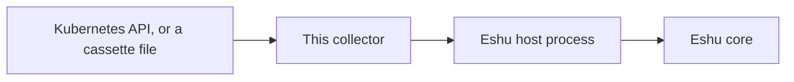
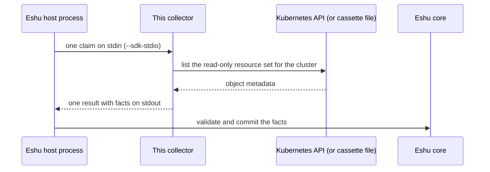
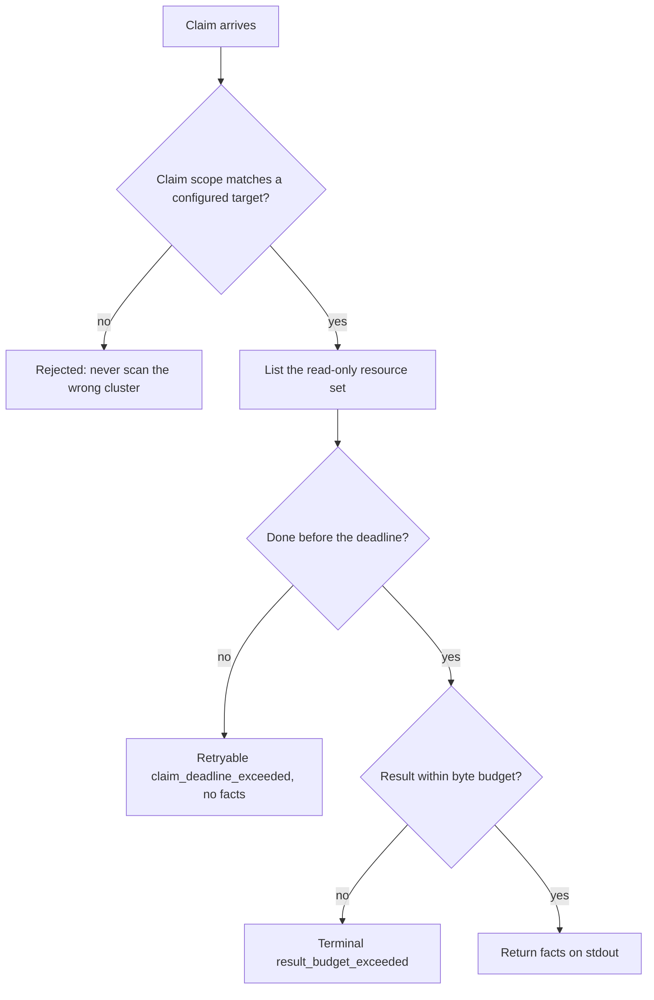

# Diagrams

Every diagram for this collector lives on this page, each with a
caption and a plain-text version so nothing depends on rendering.
Other pages link here instead of copying a diagram. (The repo
[README](../../README.md) keeps the first one as its overview.)

## 1. Where it sits

*Caption: source data flows into this collector, then to the Eshu
host process, then to Eshu core. The collector itself stores
nothing.*

Text version: Kubernetes API (or a recorded cassette file) -> this
collector -> Eshu host process -> Eshu core. A cassette is a
recorded cluster snapshot the collector can replay with no cluster
and no credentials, handy for tests.

## 2. One claim, start to finish

*Caption: one process invocation serves exactly one claim. The host
writes the request, the collector reads the claimed scope, facts
come back on stdout, and the host validates and commits.*

Text version: the host writes one `collector-sdk/v1alpha1` request to
stdin, the collector lists the read-only resource set for the one
claimed cluster and builds facts, then writes one result to
stdout. The host validates and commits.

## 3. When something goes wrong

*Caption: the failure paths. Bounded, fail-closed outcomes are
preferred over late, oversized, or silently incomplete evidence;
partial reads say so instead of pretending.*

Text version: a claim whose scope matches no target is rejected
instead of scanning the wrong cluster. The collector stops
starting work just before the deadline and returns retryable
`claim_deadline_exceeded` with no facts. A result over budget
fails terminal with `result_budget_exceeded` instead of letting
the host drop an oversized result. A cluster that can't be reached
reports retryable `collection_failed`, never a silent empty
result.
